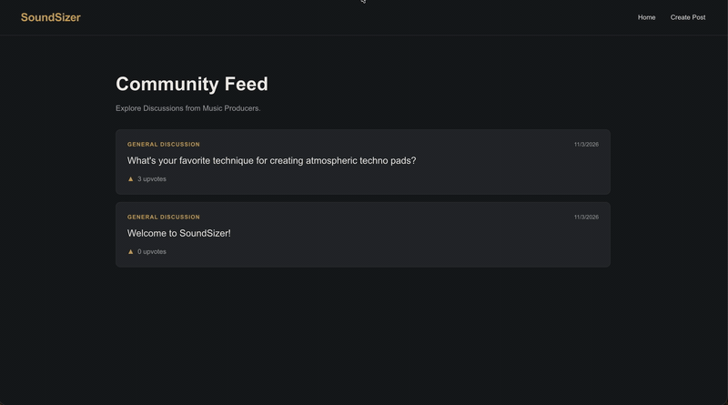
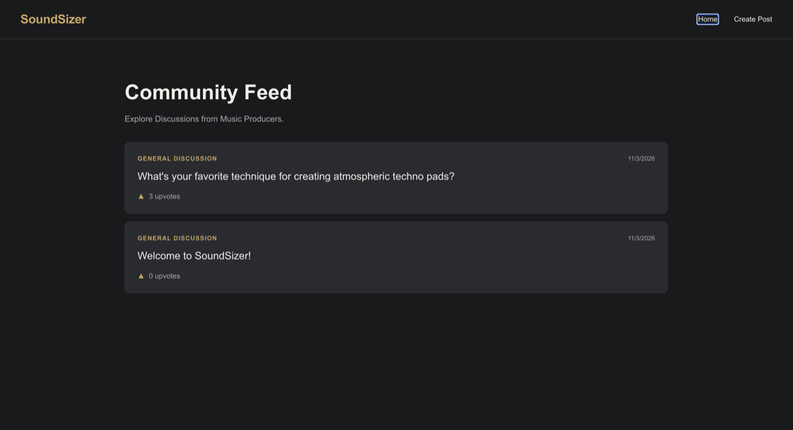
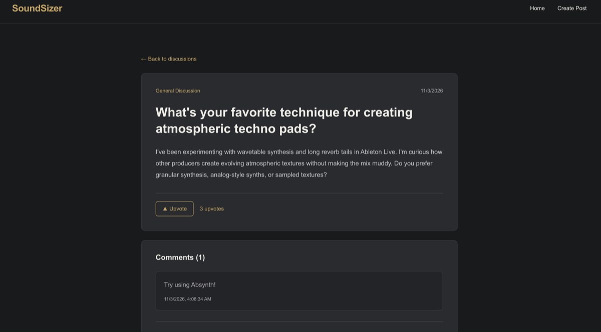
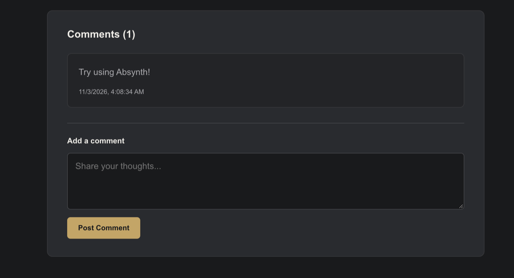
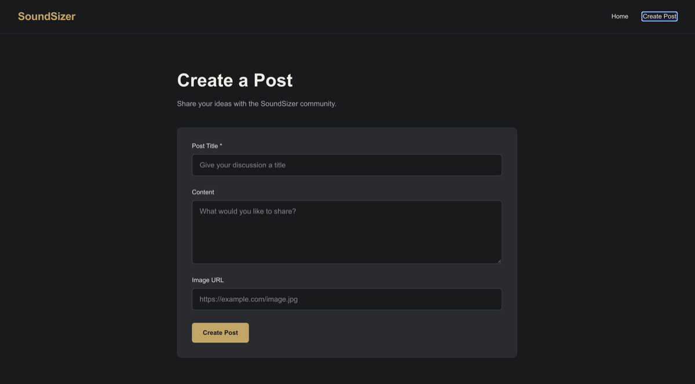

# SoundSizer

**A community discussion platform for electronic music producers, sound designers, and audio enthusiasts.**

SoundSizer is a web application where users can share production techniques, discuss audio software, ask questions, and engage with other members of the music production community.

Built as a final project for **CodePath WEB102**, SoundSizer combines a React frontend with a Supabase PostgreSQL backend to support persistent discussions and community interactions.

## App Demo



## Screenshots

### Home



### Posts



### Comments



### Create



## Tech Stack

| Technology | Purpose |
|---|---|
| React | Component-based user interface |
| Vite | Development server and build tooling |
| JavaScript | Application logic |
| React Router | Client-side navigation and dynamic routes |
| Supabase | Backend services and database access |
| PostgreSQL | Persistent storage for posts and comments |
| CSS | Custom responsive styling |

## Features

### Implemented

**Community Feed**
- Displays posts retrieved from Supabase.
- Shows post titles, categories, creation dates, and upvote counts.
- Orders posts by creation date, newest first.
- Links each post to its individual discussion page.

**Create Posts**
- Create discussions with a required title.
- Add optional text content and an image URL.
- Validate required fields before submission.
- Save posts to Supabase.
- Redirect to the community feed after successful submission.

**Individual Post Pages**
- Dynamic routes using `/posts/:id`.
- Retrieve individual posts from Supabase using their UUIDs.
- Display the post title, category, content, creation date, image, and upvote count.
- Navigate back to the community feed.
- Display loading and error states.

**Post Upvoting**
- Upvote individual posts.
- Persist upvote counts in PostgreSQL.
- Update the interface without refreshing the page.
- Use a PostgreSQL function through Supabase RPC to increment votes atomically.
- Support repeated upvotes without requiring user accounts.

**Comments**
- Display comments associated with individual posts.
- Submit new comments through a React form.
- Store comments in Supabase.
- Update the displayed comment list after successful submission.
- Preserve comments across page refreshes.
- Display comment timestamps and empty-state messages.

### Planned

- User authentication and post ownership.
- Editing and deleting posts.
- Search functionality.
- Sorting discussions by date and popularity.
- Category-based filtering.
- Embedded YouTube content.
- Additional loading animations and interface improvements.

## Design

SoundSizer follows a **Studio Minimal** design language inspired by professional digital audio workstations and music production software.

The interface uses a dark background, understated panels, clean typography, and muted gold accents.

| Element | Color |
|---|---|
| Background | `#191A1C` |
| Cards and panels | `#292B2F` |
| Accent | `#C9A45C` |
| Primary text | `#F0EDE7` |
| Secondary text | `#A9A9AD` |

The goal is to create a focused, contemporary environment that feels familiar to music producers.

## Getting Started

### Prerequisites

- Node.js and npm
- A Supabase project
- Git

### Installation

Clone the repository:

```bash
git clone <your-repository-url>
cd soundsizer
```

Install dependencies:

```bash
npm install
```

### Environment Variables

Create a `.env.local` file in the project root:

```env
VITE_SUPABASE_URL=your_supabase_project_url
VITE_SUPABASE_PUBLISHABLE_KEY=your_supabase_publishable_key
```

Obtain these values from your Supabase project settings.

Never commit `.env.local` or private service-role credentials to GitHub. The Supabase publishable key is intended for client-side use, so database access must be protected through appropriate permissions and Row Level Security policies.

### Start the Development Server

```bash
npm run dev
```

Open the local URL displayed in your terminal, typically:

`http://localhost:5173`

## Database Structure

SoundSizer currently uses two primary PostgreSQL tables.

### Posts

| Column | Type | Description |
|---|---|---|
| `id` | UUID | Unique post identifier |
| `title` | TEXT | Required post title |
| `content` | TEXT | Optional post content |
| `image_url` | TEXT | Optional image URL |
| `category` | TEXT | Discussion category |
| `created_at` | TIMESTAMPTZ | Post creation timestamp |
| `upvotes` | INTEGER | Number of upvotes |

### Comments

| Column | Type | Description |
|---|---|---|
| `id` | UUID | Unique comment identifier |
| `post_id` | UUID | References the parent post |
| `content` | TEXT | Required comment content |
| `created_at` | TIMESTAMPTZ | Comment creation timestamp |

Each post can have multiple comments. The `comments.post_id` column references `posts.id`, establishing a one-to-many relationship.

Comments are configured to be deleted automatically when their parent post is deleted.

### Upvote Function

SoundSizer uses a PostgreSQL function:

```sql
public.upvote_post(post_id UUID)
```

The function increments a post's upvote count atomically and returns the updated value.

The React application calls this function using Supabase's `.rpc()` method.

### Database Security

Row Level Security (RLS) is enabled on the posts and comments tables.

The current development configuration supports anonymous reading and creation of posts and comments. Upvotes are handled through a restricted database function rather than unrestricted direct table updates.

Authentication, ownership-based authorization, spam prevention, and rate limiting are planned improvements.

**Important:** Supabase database tables, functions, and policies are configured separately from the React source code. A fresh deployment requires the corresponding database configuration; cloning this repository alone does not recreate it.

## Application Routes

| Route | Description |
|---|---|
| `/` | Community feed |
| `/create` | Create a new post |
| `/posts/:id` | View an individual post and its comments |

React Router handles navigation between pages without requiring full browser reloads.
